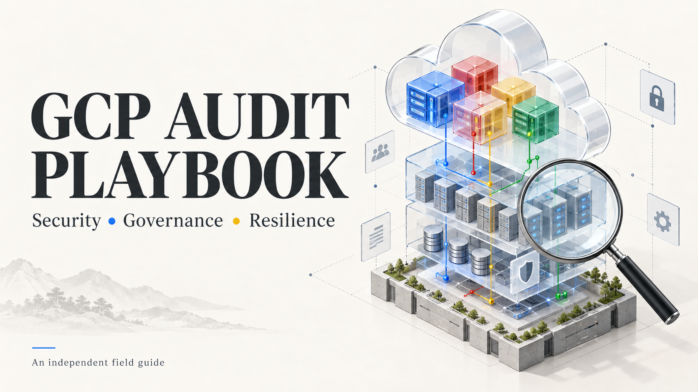

<div align="center">

# Google Cloud Audit Playbook

**An audit work program you can run, challenge and trace to its sources.**

Plan the engagement. Collect scoped evidence. Review the gaps. Deliver a supported conclusion.

**[Read the playbook](PLAYBOOK.md)** &nbsp; · &nbsp; **[Run a procedure](scripts/README.md)** &nbsp; · &nbsp; **[Explore the controls](controls/CONTROL-CATALOG.md)**

<sub>Prepared for Jeff Cadet · Independent consultant edition · v1.0 · Research reviewed 14 October 2026</sub>

</div>

---

| **100 controls** | **150 procedure scripts** | **261 references** | **36 offline tests** |
| :---: | :---: | :---: | :---: |
| Across 20 audit domains | Controls, fieldwork steps and phases | Including 256 Google sources | Synthetic responses; no customer access |

## Built for a complete engagement

A reusable Google Cloud security, governance, compliance-readiness, resilience and operational work program, with **eight fieldwork runbooks**, **18 engagement templates** and **69 documented read operations**. Google documentation accompanies the controls, scripts and technical interpretations. The auditor adopts the criteria and issues the opinion.

| Follow the source | Collect real evidence | Preserve uncertainty |
| :--- | :--- | :--- |
| Direct Google references at the point of use, plus NIST, CIS, CSA, Google SRE and OWASP perspectives. | Scripts check tools, install the missing SDK, authenticate, verify scope and acquire read-only metadata. | Errors, missing inputs and sampling limits remain visible; every assessment begins **Not assessed**. |
| [Source register →](references/SOURCES.md) | [Command register →](docs/SCRIPT-OPERATIONS.md) | [Evidence rules →](docs/COLLECTION-GUIDE.md) |

## Choose your starting point

| Your task | Open | What it provides |
| :--- | :--- | :--- |
| **Lead the engagement** | [Main playbook](PLAYBOOK.md) | Scope, access, sampling, fieldwork, risk, reporting and retest |
| **Test a control** | [Control catalog](controls/CONTROL-CATALOG.md) · [CSV](controls/control-catalog.csv) | Objective, evidence, procedure, criterion and falsification probe |
| **Follow an investigation** | [Fieldwork runbooks](docs/FIELDWORK-RUNBOOKS.md) | 40 scripted steps across access, exposure, logging, recovery, delivery and operations |
| **Collect evidence** | [Script guide](scripts/README.md) · [Coverage map](docs/SCRIPT-COVERAGE.md) | Setup, authentication, scope validation and executable entry points |
| **Prepare the deliverables** | [Engagement templates](templates/README.md) | Charter, workpapers, findings, remediation and executive report |
| **Inspect the verification** | [Disconfirmation record](research/DISCONFIRMATION.md) | Rejected assumptions, test results and remaining limits |

## The first five minutes

**Title: Preview inherited-access evidence.** **Description:** inspect the planned reads, required workpapers and source references without installing tools, signing in or querying Google Cloud. Technical basis: [Google IAM inheritance](https://docs.cloud.google.com/iam/docs/resource-hierarchy-access-control).

```sh
# Title: Preview inherited-access evidence
# Description: Print the offline plan for IAM-01.
# Reference: https://docs.cloud.google.com/iam/docs/resource-hierarchy-access-control
python scripts/controls/IAM-01.py --plan
```

Then complete the [charter](templates/engagement-charter.md), prepare a private [scope file](scripts/scope.example.json), and follow the [collection instructions](scripts/README.md). Windows users can use [Bootstrap.ps1](scripts/Bootstrap.ps1) to prepare the runtime.

**Collection sequence:** `Check tools → Install missing SDK → Authenticate → Verify organization/project scope → Read → Review`

Local setup can install software and store credentials. Cloud collection reads configuration and evidence without changing resources. Google documents the [installation](https://docs.cloud.google.com/sdk/docs/install-sdk) and [authentication](https://docs.cloud.google.com/sdk/docs/authenticate) mechanisms.

## Coverage across the estate

| Area | Domains |
| :--- | :--- |
| **Governance and identity** | Governance · Human identity · Workload identity · Organization guardrails |
| **Infrastructure and applications** | Networks · Hybrid connectivity · Compute · GKE · Serverless and messaging |
| **Data and assurance** | Storage · Databases and analytics · Keys and secrets · Logging · Detection and response |
| **Delivery and operations** | Recovery · Software supply chain · AI and agents · Operations · FinOps · Compliance and privacy |

Every domain contains five controls. Unsupported products, directory records, data-plane ACLs and application behavior require explicit supplementary evidence; see the [coverage boundaries](docs/COLLECTION-GUIDE.md#coverage-that-requires-additional-evidence). The program draws on Google's [security framework](https://docs.cloud.google.com/architecture/framework/security) and [enterprise foundations](https://docs.cloud.google.com/architecture/blueprints/security-foundations).

## Evidence behind the toolkit

| Verification | Result | Record |
| :--- | :--- | :--- |
| Adversarial collector behavior | **36 offline tests passed** | [Test results](research/test-results.json) |
| CLI command paths | **69 local help probes passed** against SDK 582.0.0 | [CLI verification](research/cli-help-checks.json) |
| Documentation | References checked for availability and reviewed for key product semantics | [Source checks](research/source-checks.json) |
| Scope of validation | **No customer organization accessed; no live cloud audit performed** | [Limits and corrections](research/DISCONFIRMATION.md) |

The missing-SDK installer is pinned to a separately documented 589.0.0 archive. Existing SDKs are preserved. Live permissions, service availability, evidence coverage and installation on every platform require an authorized engagement pilot.

## A simple instruction for your audit assistant

> Use this GCP audit playbook to audit [Company]'s approved Google Cloud scope with read-only scripts, Google-sourced findings, explicit evidence gaps, and an executive report.

Keep organization credentials and completed evidence in the company's approved private location. This public repository contains the reusable methodology and synthetic verification only.

---

Independent work by Jeff Cadet. This is not an official Google publication or a certification of compliance. [License](LICENSE) · [Contributing](CONTRIBUTING.md) · [Cover asset and prompt](assets/README.md)
